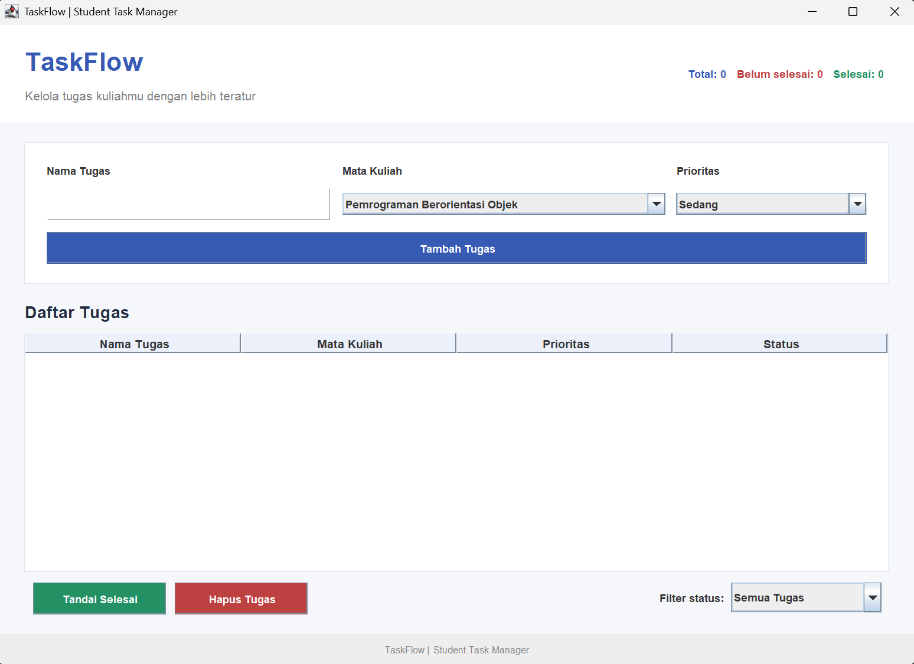
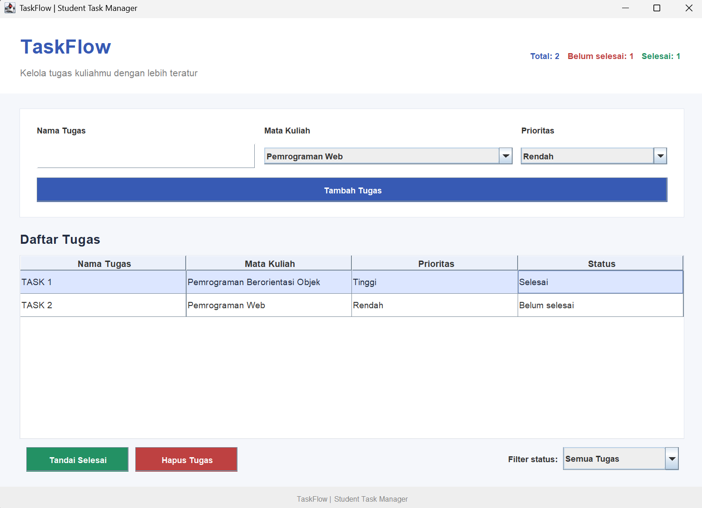
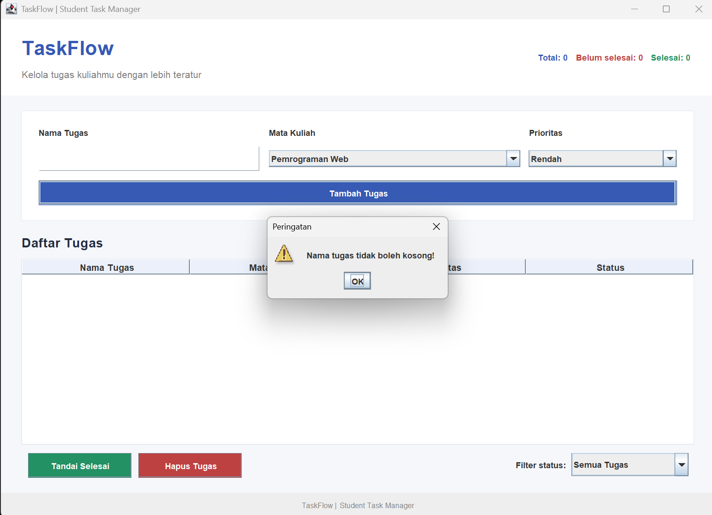

# TaskFlow — Student Task Manager

**Nama:** Muhammad Rifqy Habibi  
**NIM:** F1D02410080  

---

## 1. Deskripsi Aplikasi

TaskFlow adalah aplikasi desktop berbasis Java Swing untuk membantu mahasiswa mengelola tugas kuliah. Pengguna dapat menambahkan tugas, memilih mata kuliah dan prioritas, menandai tugas selesai, menghapus tugas, serta memfilter daftar berdasarkan status.

## 2. Fitur Aplikasi

- Menambahkan tugas kuliah.
- Memilih mata kuliah dan prioritas.
- Menampilkan tugas dalam tabel.
- Menandai tugas sebagai selesai.
- Menghapus tugas yang dipilih.
- Memfilter tugas berdasarkan status.
- Menampilkan statistik tugas.

## 3. Teknologi

- Bahasa pemrograman: Java
- Library GUI: Java Swing
- IDE: Visual Studio Code
- JDK: Java Development Kit

## 4. Komponen GUI

### Top-Level Container

- `JFrame`: jendela utama aplikasi.

### Intermediate Components

- `JPanel`: mengelompokkan komponen berdasarkan bagian tampilan.
- `JScrollPane`: menyediakan area tabel yang dapat digulir, jika digunakan pada kode.

### Atomic Components

- `JLabel`: menampilkan judul, label input, dan statistik.
- `JTextField`: menerima nama tugas.
- `JComboBox`: memilih mata kuliah, prioritas, dan filter status.
- `JButton`: menjalankan tindakan pengguna.
- `JTable`: menampilkan daftar tugas.
- `JOptionPane`: menampilkan pesan validasi atau konfirmasi.

## 5. Layout Manager

### BorderLayout

Mengatur komponen pada area utara, selatan, timur, barat, dan tengah. Digunakan sesuai penempatan komponen pada kode aplikasi.

### GridBagLayout

Mengatur komponen dalam susunan baris dan kolom yang fleksibel, jika digunakan pada kode aplikasi.

### FlowLayout

Menyusun komponen secara berurutan dalam satu baris atau beberapa baris, jika digunakan pada kode aplikasi.

## 6. Event Handling

### ActionListener

Menangani tindakan seperti klik tombol Tambah Tugas, Tandai Selesai, dan Hapus Tugas, serta perubahan pilihan filter jika didaftarkan menggunakan listener yang sesuai.

### KeyListener

Dapat digunakan untuk menangani penekanan tombol keyboard, misalnya Enter pada kolom nama tugas, jika diimplementasikan pada kode.

Catatan: nama interface dan contoh implementasinya harus disesuaikan dengan kode sumber `TaskFlow.java`.

## 7. Cara Menjalankan

Pastikan JDK telah terpasang dan terminal berada di folder utama proyek.

Kompilasi:

```bash
javac -d out src/TaskFlow.java
```

Jalankan:

```bash
java -cp out TaskFlow
```

## 8. Struktur Proyek

```text
TaskFlow/
├── src/
│   └── TaskFlow.java
├── out/
│   └── TaskFlow.class
├── screenshots/
│   ├── taskflow-preview.png
│   ├── taskflow-status.png
│   └── taskflow-validation.png
├── README.md
└── .gitignore
```

## 9. Penyimpanan Data

Data tugas disimpan sementara di memori selama aplikasi berjalan. Data tidak bertahan setelah aplikasi ditutup.

## 10. Dokumentasi Screenshot

### Tampilan Utama



### Status Tugas



### Validasi Input


